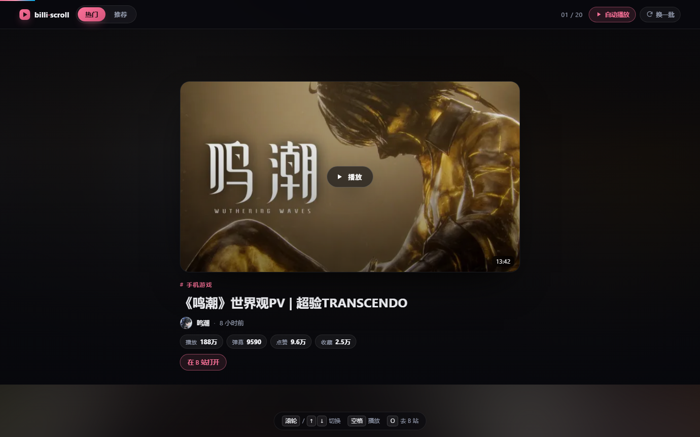
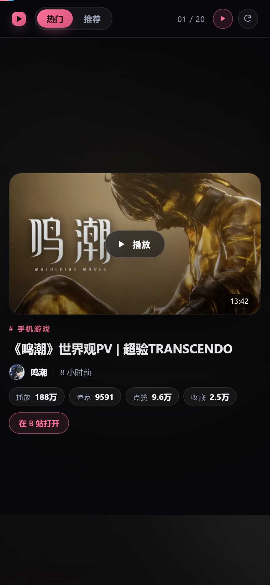
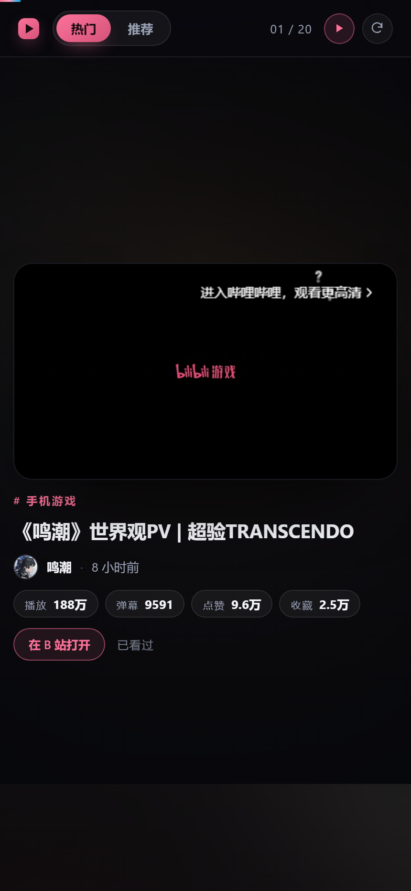

# billi·scroll

一个 B 站竖屏滑动信息流：**一屏一个视频**，滚轮 / 方向键 / 触屏上下滑切换，点一下直接在卡片里播。



<p align="center">
  
</p>

## 特性

- **一屏一张卡**：封面、标题、UP 主、播放 / 弹幕 / 点赞 / 收藏，全部一屏放得下
- **两种来源**：`热门`（按页翻）与 `推荐`（按 fresh_idx 翻），互不干扰
- **无限下滑**：滑到还剩 3 屏就自动预取下一页，去重后追加，不会重复
- **点开即播**：卡片内嵌 B 站官方播放器，同一时刻只有一个 iframe，滚走立刻销毁（不叠音、不占内存）
- **自动播放**：首次点播后，继续下滑会自动接上下一屏；可在顶栏关掉
- **换一批**：每次点击把页码往后推一格，内容真的会换（不是刷新同一批）
- **键盘友好**：滚轮、`↑/↓`、`j/k`、`PageUp/Down`、`Home/End` 都能用
- **看过标记**：播过的视频记在 localStorage，回来带「已看过」
- **细节**：`prefers-reduced-motion` 降级、`aria` 标注、图片懒加载、移动端安全区适配

## 快速开始

需要 Node.js 22+ 和 pnpm。

```bash
pnpm install
pnpm dev          # http://localhost:5319
```

其他命令：

```bash
pnpm test         # 15 个单元测试（格式化 / 归一化 / 播放器 URL）
pnpm typecheck    # tsc --noEmit
pnpm build        # 产物在 dist/
pnpm preview      # 预览构建产物，同样带 /bili 代理
```

## 快捷键

| 键 | 作用 |
|---|---|
| `滚轮` / `↓` / `j` / `PageDown` | 下一屏 |
| `↑` / `k` / `PageUp` | 上一屏 |
| `空格` / `Enter` | 播放 / 暂停当前屏 |
| `O` | 在 B 站打开当前视频 |
| `R` | 换一批 |
| `Home` / `End` | 回到顶部 / 到底 |

## 为什么需要一个代理

B 站的接口**不返回 CORS 头**，浏览器直连一定会被拦。所以前端只请求同源的 `/bili/...`，由 Vite 的 dev / preview 服务器反代到 `api.bilibili.com`，并补上 B 站风控要求的 `Referer` 和 `User-Agent`：

```ts
// vite.config.ts
'/bili': {
  target: 'https://api.bilibili.com',
  changeOrigin: true,
  rewrite: (p) => p.replace(/^\/bili/, ''),
  headers: { Referer: 'https://www.bilibili.com/', 'User-Agent': '...' },
}
```

这意味着 **`dist/` 不能直接丢到静态托管上跑**——它需要一个会转发 `/bili` 的服务端（`pnpm preview` 即可，或自己写个十几行的反代）。

## 数据来源

| 用途 | 接口 |
|---|---|
| 热门 | `api.bilibili.com/x/web-interface/popular?ps=20&pn=N` |
| 推荐 | `api.bilibili.com/x/web-interface/index/top/feed/rcmd?ps=12&fresh_type=4&feed_version=V8&fresh_idx=N&brush=N` |
| 播放器 | `player.bilibili.com/player.html?bvid=...&autoplay=...` |

两个接口的字段差异（`favorite` vs `fav`、`id` vs `aid`、直播卡片混入等）在 `src/api.ts` 的 `toVideo()` 里统一成一个 `Video` 结构，卡片只认识后者。

封面走 B 站图床的 `@宽w_高h_1c.webp` 后缀拿缩略图（原图动辄几百 KB，缩略图约 12 KB），并统一升级到 `https`，`` 上加 `referrerpolicy="no-referrer"` 规避防盗链。

## 目录

```
src/
  api.ts        接口请求、字段归一化、播放器 URL
  app.ts        滚动 / 焦点 / 预取 / 键盘 / 换源 的状态机
  card.ts       单张卡的 DOM 构建
  player.ts     只保留一个 iframe 的播放器管理
  format.ts     播放量、时长、相对时间
  store.ts      已看过（localStorage）
  types.ts      Video 类型
  styles.css    全部样式
  *.test.ts     vitest 单测
```

## 已知限制

- 没有登录，所以**拿不到 1080P / 大会员画质**，播放器是 B 站外链播放器的默认能力
- 播放器是 iframe，**没法用代码控制它的播放状态**——「暂停」实际是销毁 iframe 回到封面
- 推荐流是 B 站首页的推荐接口，参数是逆向出来的，**随时可能失效**；失效时页面会显示错误卡并提供重试
- 仅供个人学习和自用，别公开部署或做商业化使用

## 截图

| 桌面 | 移动端播放中 |
|---|---|
|  |  |

## License

MIT
